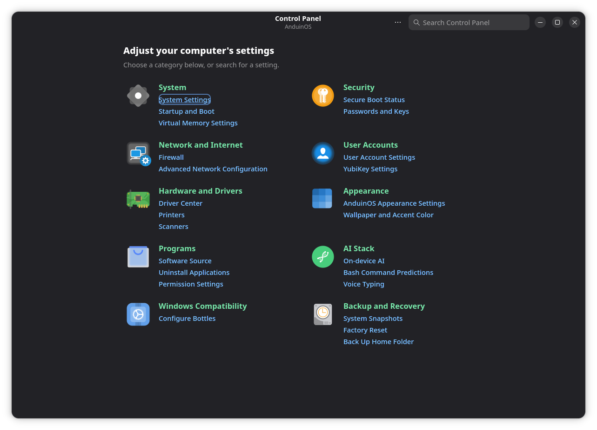
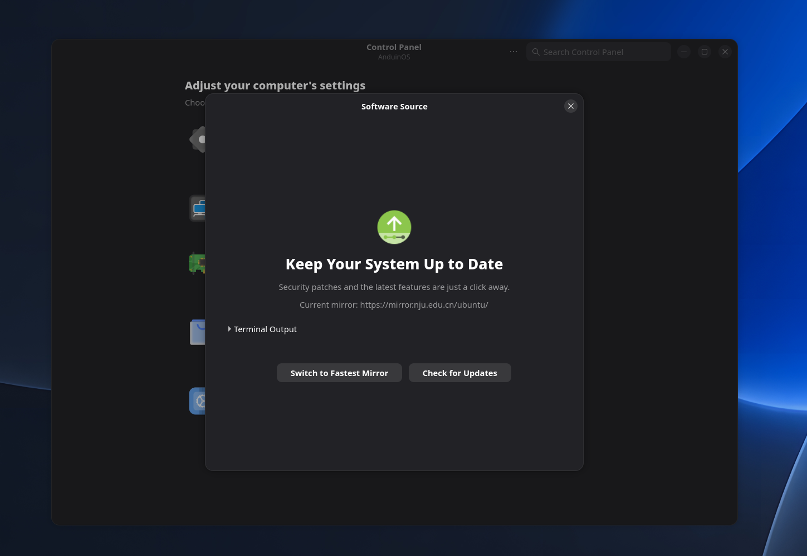

# AnduinOS Control Panel

Control Panel brings system settings, AnduinOS tools, and recovery options into one searchable window. Open **Control Panel** from the application menu, then select a category or search for a setting. Some entries open another application; others, including **Software Source**, open a settings window inside Control Panel.

## Software sources and updates

Under **Programs**, select **Software Source**, the first entry in that category. The window has **Automatic**, **Advanced**, and **Flatpak** tabs. Automatic shows the current Ubuntu mirror and provides two actions:

- **Switch to Fastest Mirror** tests available mirrors and asks before applying a different one. Applying a mirror requires administrator authorization and refreshes package indexes. If the refresh fails, the helper restores the original source and retries the refresh.
- **Check for Updates** refreshes package information and checks for available APT package upgrades. When updates are available, select **Install Updates** to install them.

**Advanced** lets you select an Ubuntu mirror or enter a custom address. Starting with 2.0.5, **Flatpak** shows the current system-wide Flathub address and provides a dropdown for **Official Flathub** or **USTC (China)**, followed by **Apply**. Applying a choice asks for administrator authorization and switches the system Flathub remote. A current custom address is shown as it is and requires an explicit choice before replacement. If Flathub is missing, it is added through the official repository descriptor before applying the selected source.

Expand **Terminal Output** to inspect progress and errors. Switching a mirror does not itself install package upgrades. Flatpak application updates are managed separately through App Store.

You can test mirrors after moving or changing networks. See [Select best APT source](../../../Install/Select-Best-Apt-Source.md) and [Update your system](../../../Install/Update-Your-System.md).

## Find a setting

Use these entries to configure the corresponding feature:

| Setting | Where to find it |
| --- | --- |
| APT mirrors, Flathub source, and system package updates | Programs → Software Source |
| Bash command suggestions | AI Stack → Bash Command Predictions |
| Offline voice input | AI Stack → Voice Typing |
| Local Network Discovery (mDNS) | Network and Internet → Firewall, then its mDNS setting |
| Automatic Btrfs snapshots | Backup and Recovery → System Snapshots, then Automatic Snapshots |
| Independent Home backups | Backup and Recovery → Back Up Home Folder |
| Online accounts | GNOME Settings → Online Accounts |

For boot-menu resolution, open **Startup and Boot** in Control Panel. It offers High resolution, Automatic, and Large text; see [GRUB Display Modes](../../../Skills/System-Management/GRUB-Display-Modes.md) for how these choices interact with the default configuration.

## Voice Typing

Voice Typing is an optional, local speech-to-text feature for AnduinOS 2. Open **AI Stack → Voice Typing** in Control Panel, or search for **Voice Typing**.

1. Select **Install Voice Typing**, review the model download information, and authorize installation with your password. An internet connection is needed to download the packages and model; recognition runs locally after installation.
2. Wait for installation to finish, then **sign out and sign back in once** to activate the desktop integration.
3. Focus a text field and press **Super + H** (the Windows key plus H). Wait for **Listening** before speaking. Press the shortcut again to stop.

### First-start performance test

With automatic backend selection, the first start without a usable saved result runs a short performance test to choose a CPU or GPU configuration. It uses bundled audio with the microphone off and a 10-second measurement budget. Model preparation follows, so the countdown is not a promise that the whole startup finishes in 10 seconds.

Starting with the 2.0.5 updates, the saved selection is reused across subsequent starts, sign-outs, reboots, package updates, and changes to the recognition model, language, or thread settings. It does not expire on a timer. If the first measurement cannot find a working candidate, the CPU fallback selection is also saved, avoiding another test at every start.

The cache belongs to your user account and is normally stored at `~/.cache/anduinos-whisper/performance.json`. If `XDG_CACHE_HOME` is set, it is stored at `$XDG_CACHE_HOME/anduinos-whisper/performance.json` instead. Deleting the file, a cache-cleaning tool removing it, or an unreadable or invalid saved result can cause automatic selection to test again. Keep this file if you want to retain the selection.

### Measure again when needed

In Voice Typing settings, select **Retest** to request a longer performance test the next time listening starts. **Restore defaults** in the performance settings also requests a retest and restores automatic backend and thread selection. These are explicit actions; ordinary use does not require them.

Automatic live transcription has a separate check for current performance evidence. After a model or configuration change, it may stop showing words while you speak even though the saved backend is still reused. Final recognition continues; this does not itself trigger another performance test.

If **Super + H** does nothing immediately after installation, finish the sign-out/sign-in step first. If the microphone is not working once listening starts, follow [Sound and Microphones](../../../Install/Troubleshoot-Sound.md).

## Backup and recovery

**System Snapshots** opens [Disk Snapshots Manager](../Disk-Snapshots-Manager/Disk-Snapshots-Manager.md) for supported Btrfs installations. The manager owns snapshot creation, automatic schedules, retention, and recovery checks.

**Factory Reset** opens the manager's reset workflow. It requires a supported Btrfs layout and the installer-created **New OS** baseline. The default preserves Home. The optional **Roll back user data** choice also resets Home and preserves its snapshot history. Read the [factory reset guide](../Disk-Snapshots-Manager/Disk-Snapshots-Manager.md#factory-reset) before confirming.

**Back Up Home Folder** opens the backup application or offers to install it. Keep independent backups even when local snapshots are enabled; both live files and same-disk snapshots can be lost with the disk. See [Backup and Restore](../../../Install/Backup-And-Restore.md).
