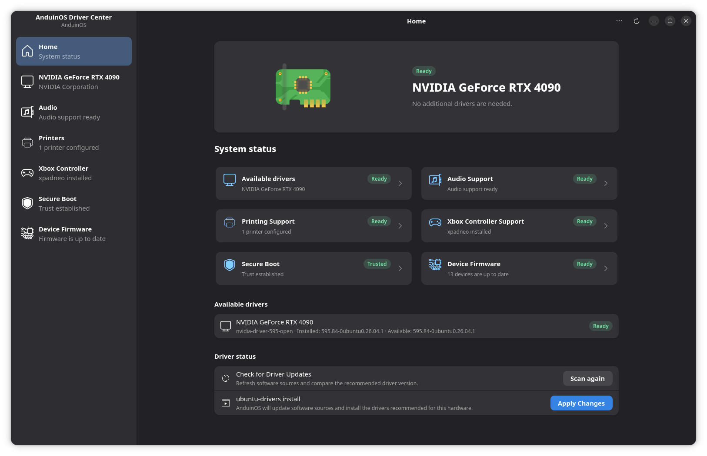
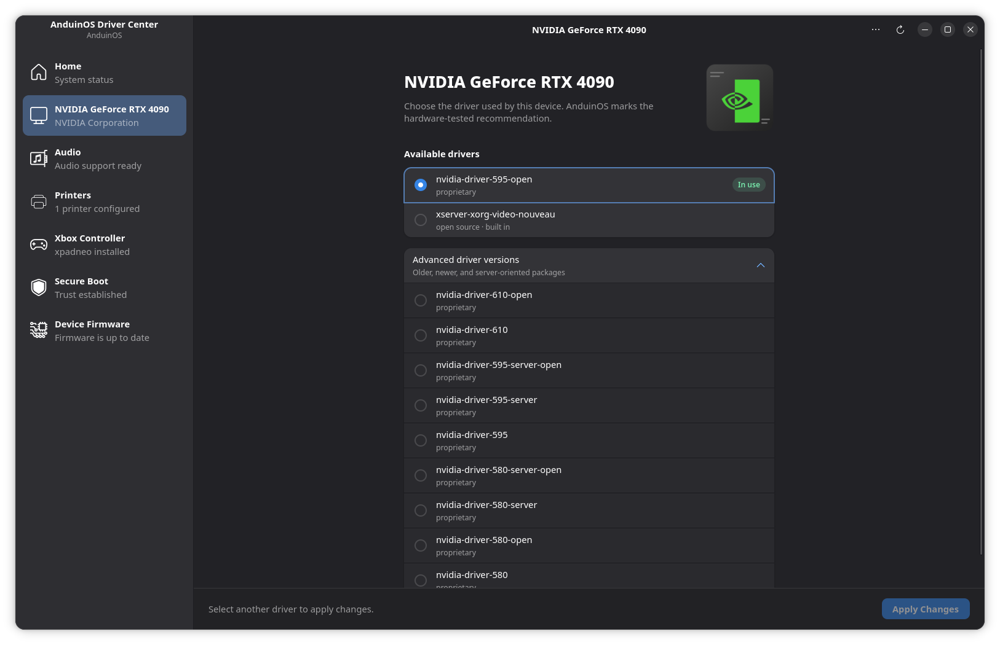
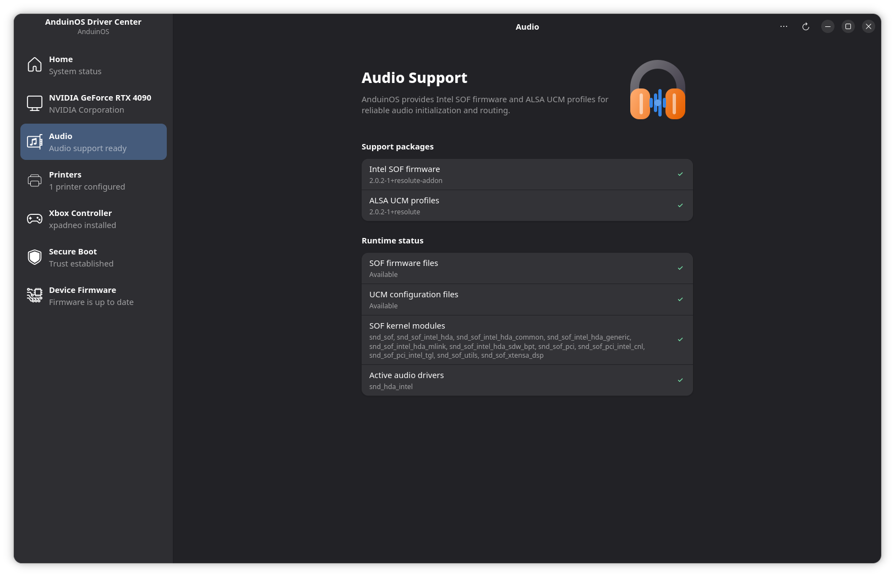
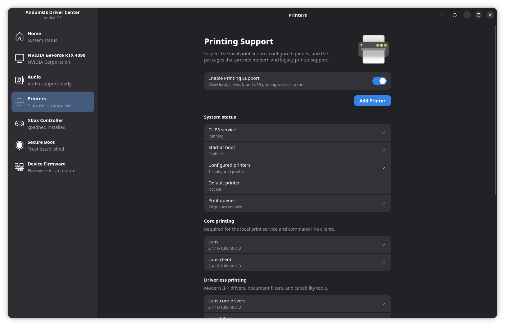
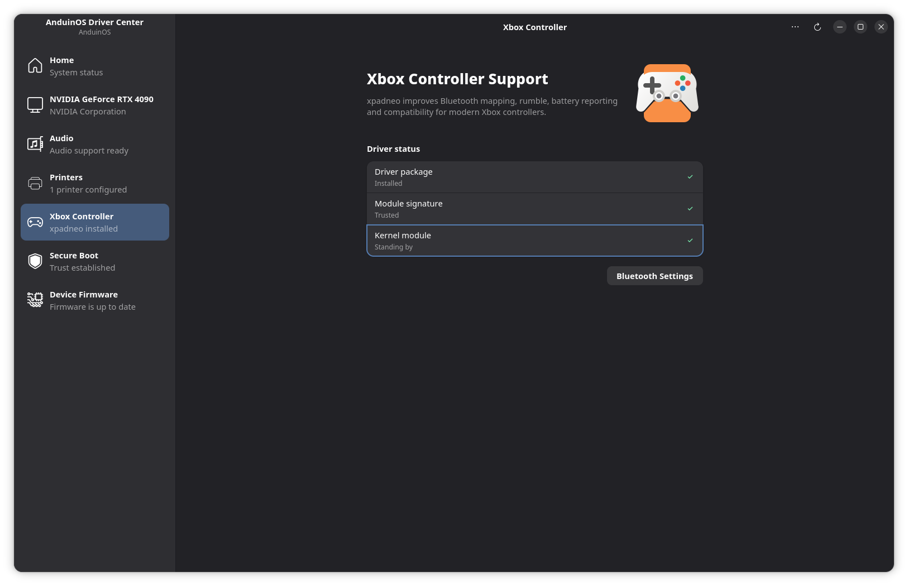
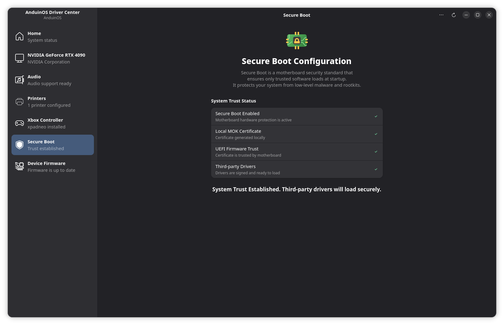
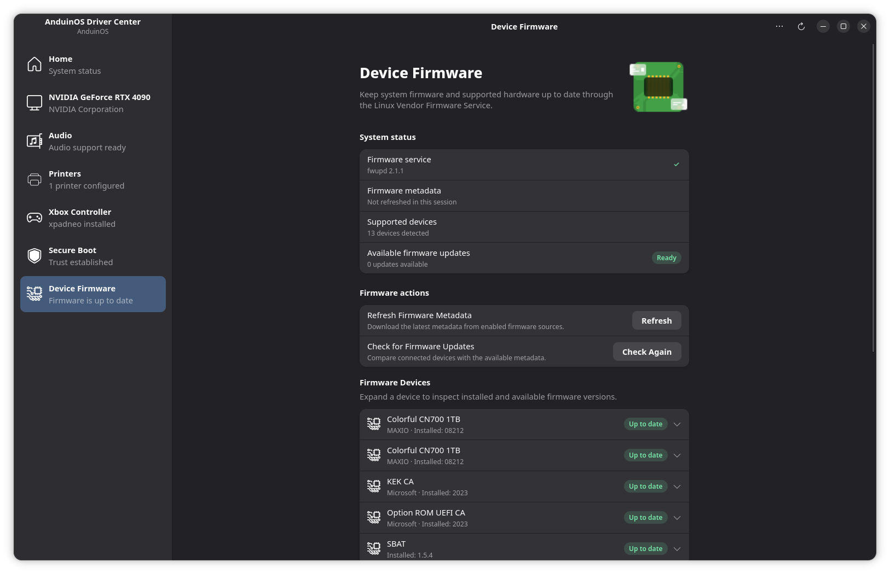

# Driver Center

Driver Center is the central place for checking hardware support in AnduinOS 2. It can inspect graphics, audio, printing, Xbox controllers, Secure Boot, and device firmware from one window.

Open the application menu, search for **Driver Center**, and launch it. The home page summarizes each area and shows whether action is required.

Most checks do not require administrator access. Driver Center asks for authentication only when an operation needs to install a package, change a service, repair driver signing, or update firmware.

## Graphics drivers

Open **Graphics** to see the detected GPU, the active driver, the recommended driver, and the other packaged drivers available for this computer.

For NVIDIA hardware, use the entry marked **Recommended for this device** unless you have a specific compatibility requirement. Select the driver, apply the change, and restart the computer when prompted.

Driver Center only offers drivers reported as suitable by Ubuntu's hardware-driver system. It does not download arbitrary installer files from a vendor website.

## Audio support

The **Audio Support** page checks the firmware, ALSA profiles, kernel modules, and active audio driver used by the computer. If an AnduinOS audio support package is missing, Driver Center can install the known package set for you.

A green result means the operating-system side of the audio stack is present. It does not guarantee that every physical jack, microphone, or Bluetooth headset is configured correctly.

## Printing and scanning

The **Printing Support** page reports whether printing is enabled, whether CUPS is running, which printers are configured, and whether the common printing packages are present.

The **Printing available on this computer** switch controls the printing services without uninstalling them. Turn it off only if you do not use printing and want the services disabled. Legacy printer drivers and scanning tools are optional on computers that use modern driverless IPP printers.

## Xbox controllers

The **Xbox Controller Support** page manages the optional xpadneo driver used by newer Xbox Bluetooth controllers.

After installing or changing the driver, restart the computer. If a previously paired controller behaves incorrectly, remove it from Bluetooth settings and pair it again.

When Secure Boot is enabled, the controller driver must also be signed by a certificate enrolled in the machine's MOK trust store. Driver Center checks this before installing the driver and directs you to the Secure Boot page when action is needed.

## Secure Boot and driver signing

The **Secure Boot** page separates these conditions for the new AMD64 boot stack:

1. Secure Boot is enabled in the computer's firmware.
2. A local AnduinOS MOK certificate exists.
3. The certificate permits both GRUB and kernel-module signing.
4. The certificate is enrolled in shim's MOK trust store.
5. Third-party kernel modules have trusted signatures and automatic signing is configured.
6. The AnduinOS GRUB/shim packages are installed and the deployed GRUB is signed and trusted.

The screenshot shows an earlier interface. New versions add certificate permissions and bootloader checks. Follow the action next to the condition requiring attention; certificate enrollment still requires confirmation in MOKManager after restarting. Once enrolled, the new identity is used without a separate **Use** step.

Existing installations using Ubuntu's signed bootloader do not need to migrate merely to receive 2.0.5 updates. A module-only certificate or an absent AnduinOS GRUB package does not by itself mean that the existing Ubuntu boot chain is untrusted. See the [boot-stack guide](../../../Install/Secure-Boot-Signing-Architecture.md) before choosing an optional migration, and the [Secure Boot Guide](../../../Install/First-Boot-For-Secure-Boot.md) for enrollment and recovery.

Signing readiness is not a hardware functionality test. A signed module may still need a restart, device pairing, or hardware-specific configuration.

## Device firmware

The **Device Firmware** page uses the system `fwupd` service. It lists supported devices, refreshes firmware metadata, installs available updates, reports progress, and records update history.

Not every device supports firmware updates through Linux. A device missing from this list may require an update supplied by its manufacturer. Keep the computer connected to power and do not interrupt a firmware update. Restart when Driver Center requests it.

## Troubleshooting

If the window becomes blank after the hardware scan or a refresh, update `anduinos-driver-center` and reopen it. AnduinOS 2.0.5 fixes a failure while building the hardware navigation and Secure Boot summary; this symptom alone does not establish that a driver installation failed.

If a page cannot refresh or install a package:

1. Confirm that the computer can reach the configured software source.
2. Refresh the package index with `sudo apt update`.
3. Reopen Driver Center and repeat the check.
4. If package management was interrupted, run `sudo dpkg --audit` and resolve any reported issue before installing another driver.

For command-line alternatives and hardware-specific guidance, see [Install Drivers](../../../Install/Install-Drivers.md).
