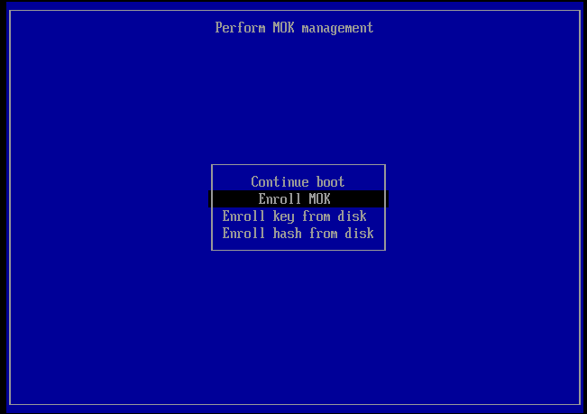

# Secure Boot Guide

AnduinOS supports UEFI Secure Boot while still allowing trusted third-party kernel modules, such as the optional Xbox controller driver, to load. New AMD64 installations starting with 2.0.5 also use a locally signed AnduinOS GRUB bootloader.

The installer creates a certificate owned by the newly installed computer. On the first restart, you confirm that certificate in the firmware-level MOKManager screen. This is a one-time physical-presence step; it does not disable Secure Boot.

!!! important "The enrollment code is 123456"

    The installer uses the one-time MOK enrollment code `123456`. You do not create this code in the installer, and it is not your user password or disk-encryption password.

!!! note "Already running an older installation?"

    Ordinary AnduinOS 2.0 updates do not require migrating a working Ubuntu bootloader or enrolling a new certificate. This guide's new-GRUB enrollment requirement applies to fresh installations and deliberate migrations. See [why existing users need no migration](./Secure-Boot-Signing-Architecture.md#existing-installations-and-optional-migration).

## Before installation

1. Open the computer's UEFI settings. The setup key is commonly `F2`, `F10`, `Del`, or a model-specific button.
2. Find **Secure Boot** under the **Security** or **Boot** section.
3. Enable Secure Boot. If the firmware asks for a mode, use **Standard** or **Windows UEFI mode**, not a custom-key mode.
4. Save the settings and boot the AnduinOS USB drive in UEFI mode.

The installer detects the running firmware state. For the new AMD64 boot stack, it creates a machine-local certificate suitable for GRUB and kernel modules, signs and verifies the target GRUB, and prepares relevant DKMS modules. With Secure Boot enabled, it requests and verifies MOK enrollment before installation completes. The USB itself uses official signed boot files and does not need this local certificate.

When Secure Boot is disabled, the installer still prepares the identity and signed GRUB, but does not automatically queue enrollment. Installation without Secure Boot enforcement does not establish trust for enabling it later.

## First restart: enroll the certificate

After an installation performed with Secure Boot enabled, the first restart opens a blue **MOKManager** screen before AnduinOS starts.

1. Select **Enroll MOK**.



2. Select **Continue**, then select **Yes** to confirm the certificate.


3. Enter `123456`. MOKManager normally uses a US keyboard layout.
4. Select **Reboot**.

The following boot should enter the installed AnduinOS desktop with Secure Boot still enabled.

!!! warning "Do not skip enrollment with the new boot stack"

    With Secure Boot enabled, shim must trust the certificate that signed the installed AnduinOS GRUB. Skipping enrollment can prevent the installed system from booting, not just stop optional drivers from loading. An older Ubuntu-signed boot stack does not have this local-GRUB requirement, but still needs trusted signatures for locally built modules.

## Verify the result in Driver Center

Open **Driver Center**, then select **Secure Boot**. On a fully configured new AMD64 installation, check all six areas:

- Secure Boot is enabled.
- The local MOK certificate exists.
- The certificate permits both GRUB and kernel-module signing.
- The certificate is enrolled in shim's MOK trust store.
- Installed third-party kernel modules have trusted signatures and signing is configured.
- The AnduinOS boot stack is installed, signed, and trusted.


The screenshot shows an earlier interface; newer versions also expose certificate permissions and bootloader state. Enrollment is used automatically, without a separate **Use** button.

You can also verify the firmware state from a terminal:

```bash title="Check Secure Boot status"
mokutil --sb-state
```

The expected result is `SecureBoot enabled`.

## If enrollment was skipped or did not finish

If MOKManager still offers the pending request, complete enrollment there. If the installed system cannot start, boot the installation USB for recovery; do not assume that you can reach Driver Center through an untrusted GRUB. Temporarily disabling Secure Boot can allow access to an otherwise working installation for repair; re-enable it only after enrollment and readiness checks succeed.

When the installed system is accessible, open **Driver Center → Secure Boot**. Follow the action for the detected state:

- If no local certificate exists, select **Create & Enroll Certificate**.
- If enrollment is pending, select **Reboot & Configure Secure Boot**.
- In MOKManager, follow **Enroll MOK** → **Continue** → **Yes** and enter `123456`.
- After returning to AnduinOS, reopen Driver Center and verify the certificate, driver, and applicable bootloader checks.

The Welcome to AnduinOS application links to Driver Center. Driver Center is the place to inspect or repair enrollment and signing; the welcome flow does not maintain a separate certificate or enrollment state.

## If Secure Boot is shown as disabled

Driver Center cannot enable a motherboard setting from inside the operating system. **First prepare and enroll the local certificate and verify boot readiness in Driver Center. Then enable Secure Boot in UEFI settings.** A locally signed GRUB must be trusted before firmware enforcement is enabled.

If the firmware offers **Setup Mode**, **Custom Keys**, or **Restore Factory Keys**, consult the computer manufacturer's instructions before changing its key database. MOK enrollment and firmware platform-key provisioning are different operations.

## Command-line certificate check

Advanced users can check whether the current machine certificate is enrolled:

```bash title="Check the AnduinOS MOK certificate"
sudo mokutil --test-key /var/lib/shim-signed/mok/MOK.der
```

The command should report that the certificate is already enrolled. Keep `/var/lib/shim-signed/mok/MOK.priv` private; it is the local signing key used for GRUB and locally built modules on the new boot stack.

For implementation details, see the [Secure Boot Signing Architecture](./Secure-Boot-Signing-Architecture.md).
