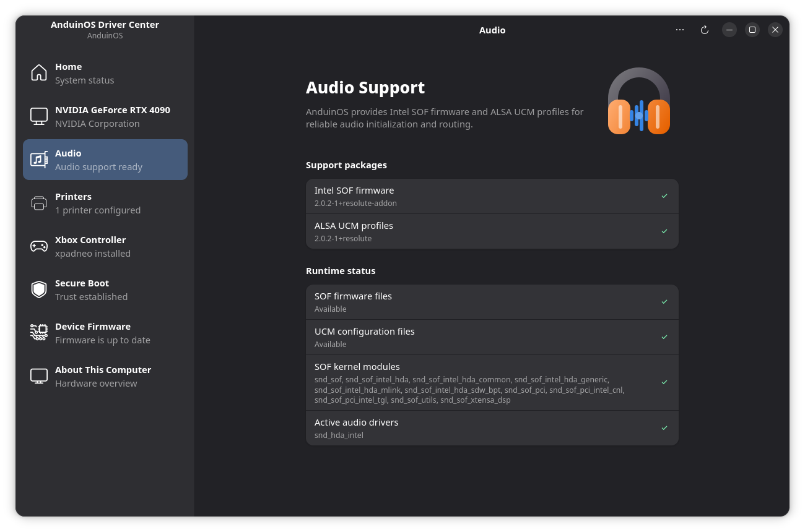

# Troubleshoot sound and microphones

Follow your symptom below, changing one thing at a time. Driver Center and PipeWire service instructions apply to AnduinOS 2.

## Check the basics

Open **Settings → Sound**:

- **Output:** select your speakers/headset, unmute, adjust volume and click **Test…**. Check physical power, volume and mute controls too.
- **Input:** select your microphone, unmute and adjust **Input Volume**. Speak and check the input meter.

Input and output are selected separately; reconnecting devices may change the selection.

{ width=840 }

| What happens? | Go to |
| --- | --- |
| No sound, missing device or Dummy Output | [Restore a missing device](#no-sound-or-missing-device) |
| Microphone silent, quiet or distorted | [Check the microphone](#microphone-problems) |
| Only one application or website fails | [Check application settings](#only-one-application-fails) |
| Bluetooth disconnects or sounds muffled during calls | [Check Bluetooth audio](#bluetooth-headsets) |
| Crackling, echo, delay or a pop after idle | [Identify the noise](#noise-echo-or-delay) |
| Audio fails after an update or waking from sleep | [Compare before and after](#after-an-update-or-suspend) |

## No sound or missing device

1. **Analogue:** check the socket and headset adapter. **USB:** try another port without a hub. **HDMI/DisplayPort:** select that output and check the monitor has speakers or an audio output.
2. Try another headset/speaker to isolate a device or cable problem.
3. Open [Driver Center](../Applications/System/Driver-Center/Driver-Center.md) → **Audio**, apply offered fixes and reboot if requested. Green checks confirm software components; test the sound separately.

{ width=840 }

**Dummy Output** means no usable output is exposed to the sound server. Check services as your desktop user, without `sudo`:

```bash
systemctl --user status pipewire pipewire-pulse wireplumber
```

If services failed or audio stopped responding, finish calls/recordings before restarting:

```bash
systemctl --user restart pipewire pipewire-pulse wireplumber
```

Retest. If a service or device remains missing, [collect diagnostics](#still-not-working).

## Microphone problems

- **No input meter activity:** check the hardware mute switch, input device and jack/adapter. Try another microphone or USB port.
- **Meter responds, but the app records silence:** follow [application settings](#only-one-application-fails).
- **Quiet or distorted throughout:** adjust input volume and external-interface gain. Compare a local recording with a call to check whether the problem is in capture or the call.
- **Only the start of a recording is distorted:** try the [HDA power-saving check](#hda-clicks-after-idle) if applicable.

## Only one application fails

Check the app's devices, mute, volume and microphone permissions. In browsers, check site permissions and tab mute too. Reopen the app after changes and compare another app.

## Bluetooth headsets

Connect in **Settings → Bluetooth**, then select the headset in Sound settings. For pairing/disconnections, follow the [Bluetooth guide](./Troubleshoot-Network-and-Bluetooth.md).

Classic Bluetooth headsets may switch from **A2DP** music playback to lower-quality **HFP/HSP** when using the microphone. For music quality, select another microphone, close apps using the headset mic and choose the high-quality profile if available. [Profile support varies by headset](https://pipewire.pages.freedesktop.org/wireplumber/daemon/configuration/bluetooth.html).

## Noise, echo or delay

- **Crackling/dropouts:** lower excessive volume/gain; compare local playback with streaming and another cable/port/headset. Note whether heavy load triggers it.
- **Echo/feedback:** try headphones and disable microphone monitoring in the app. Speakers feeding into your microphone can cause call echo.
- **Delay:** compare wired/USB with Bluetooth and check the app's monitoring/latency settings.
- **A click, pop or distorted fade-in only when audio starts after idle:** follow the HDA check below.

### HDA clicks after idle

HDA [power-state changes can cause noise](https://docs.kernel.org/sound/designs/powersave.html). Disabling codec power saving helped in [Discussion #482](https://github.com/Anduin2017/AnduinOS/discussions/482), but can increase idle power use and may reduce battery life.

**Test first.** Record the fault, finish calls/recordings and note the current timeout:

```bash
cat /sys/module/snd_hda_intel/parameters/power_save
```

If the file is absent or reads `0`, skip this workaround. A positive value is the idle timeout in seconds; temporarily disable it with:

```bash
echo 0 | sudo tee /sys/module/snd_hda_intel/parameters/power_save
```

The change may click. Keep device, gain and `power_save_controller` unchanged. Test recording/playback immediately and after a few idle minutes. Reboot restores the boot setting. Persist only if it helped.

**Keep the workaround.** It affects all `snd_hda_intel` devices. Create this file; review existing contents before editing:

```bash
sudo nano /etc/modprobe.d/99-local-hda-no-powersave.conf
```

Enter this line, save with **Ctrl+O**, **Enter**, then exit with **Ctrl+X**:

```text
options snd_hda_intel power_save=0
```

Update existing boot images:

```bash
sudo update-initramfs -u -k all
```

Reboot only after success; seek help on errors. Recheck with the `cat` command: expect `0`. Retest recording/playback immediately and after idle; report if the value changes later.

**Undo.** Remove only the dedicated file you created above:

```bash
sudo rm /etc/modprobe.d/99-local-hda-no-powersave.conf
```

Run `sudo update-initramfs -u -k all` again; after success, reboot and recheck the timeout.

## After an update or suspend

Recheck devices and restart audio services as above. Apply [system updates](./Update-Your-System.md) and reboot. For recurring wake failures, collect logs immediately and follow [sleep diagnostics](../Skills/System-Management/Diagnose-Sleep.md).

Compare an earlier installed kernel or Live USB, recording each version and result. Different software versions help narrow the cause but do not prove it.

## Still not working?

Ask in [community discussions](https://github.com/Anduin2017/AnduinOS/discussions) with [system/kernel versions](./Troubleshooting.md), hardware models, connection, symptom, onset and test results. Review output for private information before posting.

Run these individually as your desktop user. Include relevant output or any error:

| Command | What it shows |
| --- | --- |
| `wpctl status` | Devices and streams visible to PipeWire |
| `aplay -l` and `arecord -l` | ALSA playback and recording hardware |
| `lspci -nnk` and `lsusb` | PCI/USB hardware IDs and PCI drivers |
| `journalctl --user -b -u pipewire -u pipewire-pulse -u wireplumber --since '-10 minutes'` | Recent audio-service errors |
| `journalctl -b -k` | Kernel messages; include audio/firmware errors near the failure |

For HDA power-saving problems, also include `lspci -nnv -d ::0403`, the original/tested timeout, idle duration and reboot results. Get codec identifiers with:

```bash
grep -H -E '^(Codec:|Vendor Id:|Subsystem Id:)' /proc/asound/card*/codec*
```

If multiple computers are affected, say whether they share the same microphone or adapter.
