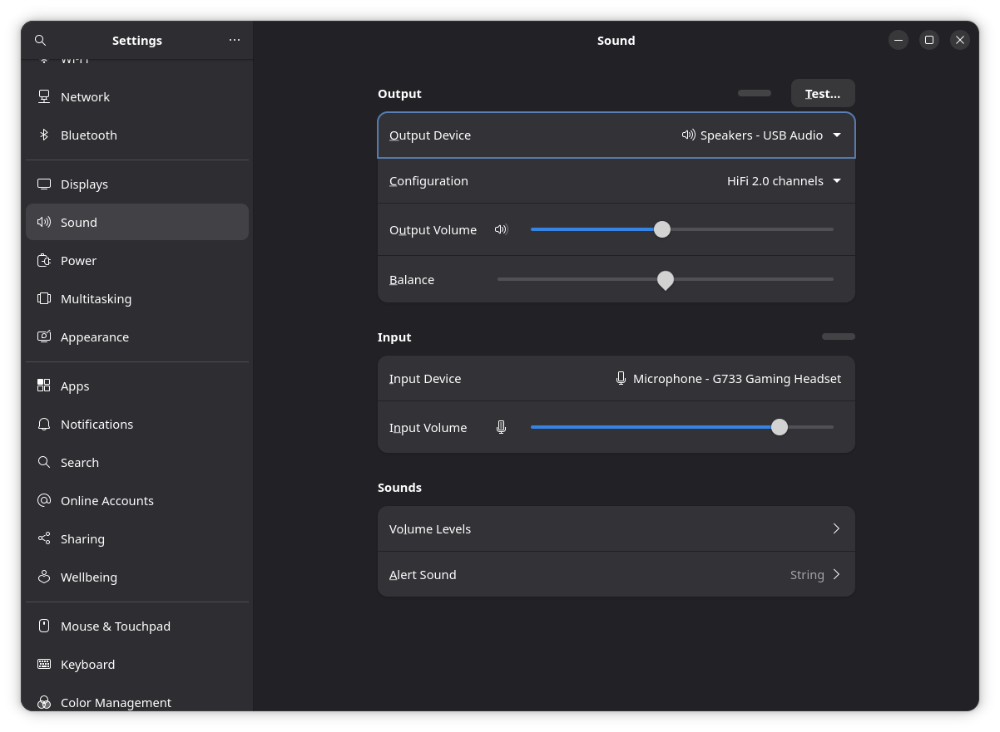

# No sound, Dummy Output or microphone not working

## Confirm the version and symptom

Record the [system version](./Troubleshooting.md), whether you use built-in speakers, HDMI, USB or Bluetooth audio, and whether the problem affects every application. AnduinOS 2 desktop packages use PipeWire, its PulseAudio compatibility service and WirePlumber.

## Simple checks

Open **Settings → Sound**. Under **Output**, choose **Output Device**, adjust **Output Volume**, and use **Test…** at the upper right. Under **Input**, choose your microphone and adjust **Input Volume**. Check the physical mute switch and whether the input meter responds when you speak.

{ width=840 }

The example plays through **Speakers - USB Audio** and records through **Microphone - G733 Gaming Headset**. Playback and recording can use different devices. HDMI monitors can also become the selected output, so check the selected device rather than only raising the volume. If just one application fails, check its own device selection and microphone permission; browser site permissions are separate.

Disconnect and reconnect a USB headset. For Bluetooth, compare a wired headset: microphone use can change the available Bluetooth audio profile and playback quality.

## Collect diagnostic information

Run these as your desktop user, without `sudo`:

```bash
wpctl status
systemctl --user status pipewire pipewire-pulse wireplumber
journalctl --user -b -u pipewire -u pipewire-pulse -u wireplumber --since '-10 minutes'
```

Also inspect `lspci -nnk`, `lsusb`, and kernel messages with `journalctl -b -k` for missing audio firmware. `Dummy Output` means there is no usable real output exposed to the sound server; it does not identify a single cause.

## Choose the next step

If devices appear in `wpctl status`, select the correct output/input in Settings and retest another application. For an application-only failure, inspect its permissions and audio settings before changing system packages.

If the desktop audio services failed, save work involving audio, then restart them for your user:

```bash
systemctl --user restart pipewire pipewire-pulse wireplumber
```

This interrupts active calls and recordings. Retest afterwards. If services or hardware support packages are missing, open **Driver Center → Audio** and review the **Audio Support** page and any proposed fix. A green status checks known software components, not every microphone, physical jack or headset. Reboot after firmware or driver updates when requested.

{ width=840 }

The sidebar reports **Audio support ready**. **Support packages** lists Intel SOF firmware and ALSA UCM profiles; **Runtime status** lists available files, modules and active audio drivers. Green checks here describe those components. Use the Sound settings above to confirm that your actual speakers and microphone work.

## Clicks or distorted audio when recording starts

Some HDA audio devices produce a click, distorted fade-in or playback pop when waking from automatic power saving. This is one possible cause, not a diagnosis for every audio problem. In [Discussion #482](https://github.com/Anduin2017/AnduinOS/discussions/482), disabling HDA codec power saving resolved a recording startup transient, including after reboot and idle, while normal playback continued to work.

### Test a temporary workaround

First make a short recording that demonstrates the problem. Keep the same microphone, input selection and recording volume throughout the comparison. Finish any call or recording before changing the setting: changing the audio power state can itself produce a click.

Read the current timeout and note its value so you can identify the original configuration:

```bash
cat /sys/module/snd_hda_intel/parameters/power_save
```

`0` means automatic codec power saving is disabled. A positive number is the idle timeout in seconds. If the file does not exist, this workaround does not apply to your current driver. If it already reads `0`, leave it unchanged and collect diagnostics below.

If the value is positive, temporarily disable automatic codec power saving:

```bash
echo 0 | sudo tee /sys/module/snd_hda_intel/parameters/power_save
```

Repeat the recording that previously failed, then repeat it after leaving audio idle for a few minutes. Also check normal speaker or headphone playback. Leave `power_save_controller` and other audio settings unchanged so the comparison tests one change.

For a direct ALSA comparison, first list the capture devices:

```bash
arecord -l
```

If the affected microphone is on **card 0, device 0**, record five seconds with:

```bash
arecord -D plughw:0,0 -f cd -d 5 /tmp/hda-mic-test.wav
```

Replace `0,0` with the card and device numbers shown for your microphone. This command replaces that temporary recording file. Use the same command before and after the setting change. If `arecord` is unavailable, the device is busy or the command fails, include that message when asking for help; a failed recording command does not demonstrate an audio-quality problem.

Rebooting restores the boot configuration after this temporary change. If disabling power saving does not help, reboot and investigate another cause instead of making the setting permanent.

### Keep a setting that has helped

This workaround affects devices handled by `snd_hda_intel` on this computer, rather than only one microphone. It can increase idle power consumption and reduce battery life. Apply it only after the temporary comparison improves the affected audio.

Open a dedicated configuration file:

```bash
sudo nano /etc/modprobe.d/99-local-hda-no-powersave.conf
```

If this file already contains settings, stop and review them before changing it. For a new file, enter this single line:

```text
options snd_hda_intel power_save=0
```

Save with **Ctrl+O**, press **Enter**, then exit with **Ctrl+X**.

Update existing boot images so the option is available even when the driver loads early:

```bash
sudo update-initramfs -u -k all
```

Wait for the command to finish successfully. If it reports an error, ask for help with that error before proceeding. Save your work and reboot normally.

After reboot, verify the effective value:

```bash
cat /sys/module/snd_hda_intel/parameters/power_save
```

It should return `0`. Repeat the immediate recording, the recording after idle and normal playback. If the value changes back despite keeping the file, report when it changes and any installed power-management tools; another component may be changing it at runtime.

### Undo the persistent workaround

If you created the dedicated file above, remove that file:

```bash
sudo rm /etc/modprobe.d/99-local-hda-no-powersave.conf
```

Update the existing boot images again:

```bash
sudo update-initramfs -u -k all
```

Wait for success, then reboot. This restores the previous boot configuration. Check the effective value again; it depends on your kernel and any other power-management configuration.

### Information for a hardware-specific report

Include your system and kernel versions, motherboard or laptop model, microphone model, and whether you use a built-in microphone, an analogue jack or a USB adapter. State whether the issue affects recording, playback or both, and whether direct ALSA recording shows it too. For two affected computers, identify whether they share the same microphone or adapter.

Show the audio controller and its subsystem IDs:

```bash
lspci -nnv -d ::0403
```

Show the codec identifiers:

```bash
grep -H -E '^(Codec:|Vendor Id:|Subsystem Id:)' /proc/asound/card*/codec*
```

Include the original and tested `power_save` values, the idle interval, and results after reboot. Review diagnostic output before posting it. These details help distinguish a specific hardware compatibility problem from an application or sound-server issue.

The [Linux kernel power-saving documentation](https://docs.kernel.org/sound/designs/powersave.html) describes the timeout and possible noise during power-state transitions. Increasing the timeout can reduce frequent transitions, but still permits the device to sleep after a longer idle period; it does not guarantee a clean first recording on affected hardware.

## When to ask for help

If Dummy Output remains, provide the sound-server status, audio hardware IDs and the relevant firmware error. Say whether a Live USB, USB headset or earlier kernel works. Do not replace PipeWire with another sound server merely to test a single application.
