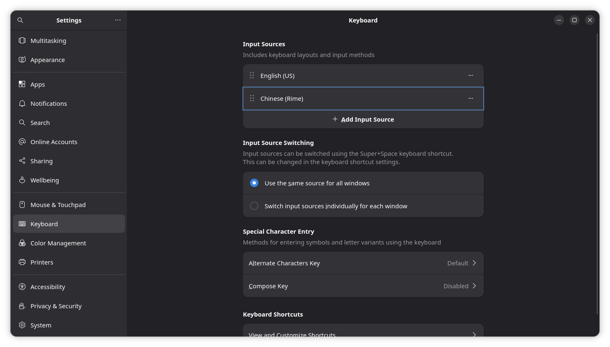
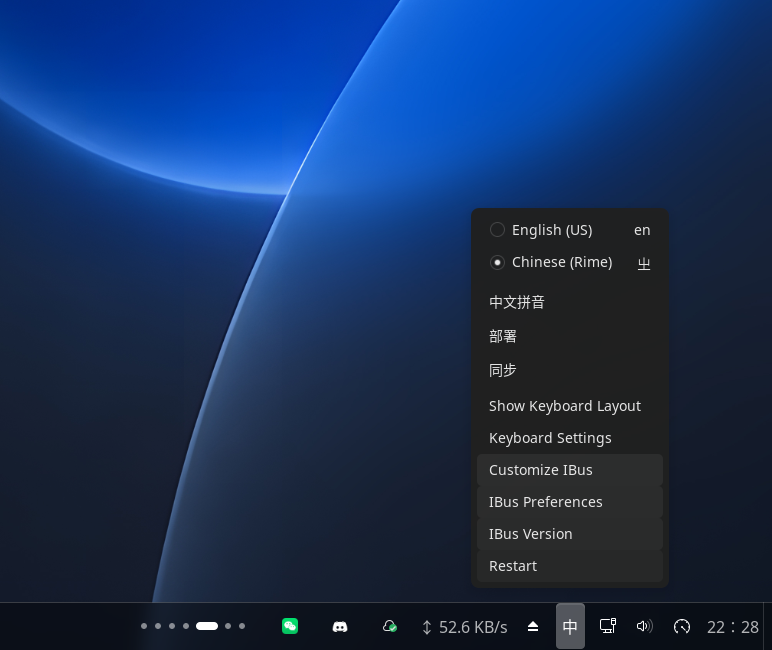
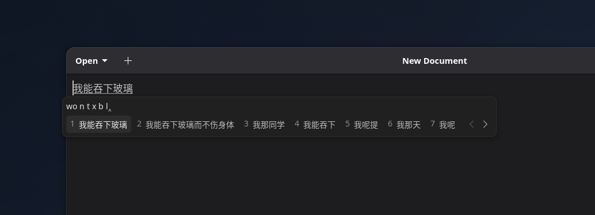
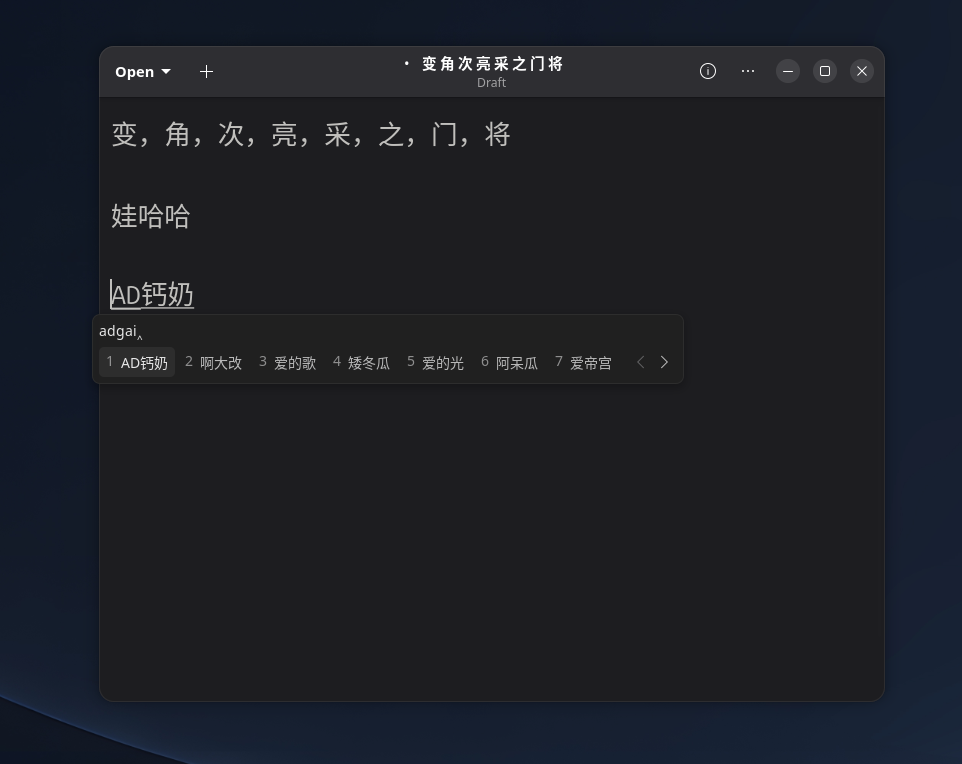
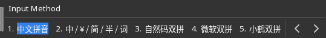

# Type Chinese with Rime

AnduinOS uses Rime as its Chinese input method. Rime provides Pinyin input, learns from the candidates you select, and can mix Chinese and English in the same document.

On a new installation, the AnduinOS Installer offers Rime when you select Simplified Chinese and the package source is reachable. It is not installed on every system, so users who do not type Chinese do not receive the additional dictionaries and input-method packages.

## Install Rime when it is missing

If **Chinese (Rime)** is not available in Settings, install the AnduinOS configuration and the Rime engine:

```bash
sudo apt update
sudo apt install anduinos-rime
```

Log out and log back in after installation. This lets GNOME and IBus discover the new input method cleanly.

## Add the input source

1. Open **Settings**.
2. Select **Keyboard**.
3. Under **Input Sources**, select **Add Input Source**.
4. Add **Chinese (Rime)**.

English and Rime can remain in the list together.



## Switch between English and Chinese

Press <kbd>Super</kbd> + <kbd>Space</kbd> to move to the next input source. The input indicator on the taskbar changes to show the active source.

You can also select the indicator directly. The Rime menu provides access to its current input mode, deployment, synchronization, and IBus settings.



## Type with Pinyin

With **Chinese (Rime)** selected:

1. Type the full Pinyin for the text you want (the default scheme).
2. Review the numbered candidate list.
3. Press the candidate number, or use the arrow keys and <kbd>Space</kbd>, to commit a candidate.
4. Use the arrows at the right side of the candidate window to view more candidates.



Rime can produce normal Chinese text while retaining English words, letters, and numbers where they are appropriate. The AnduinOS package also includes candidate filtering that keeps useful spelling guidance without displaying internal Pinyin annotations beside every ordinary candidate.



## Switch between full Pinyin and Shuangpin

Starting with AnduinOS 2.0.5, AnduinOS Rime includes three Shuangpin layouts: **Natural Code (自然码双拼)**, **Microsoft (微软双拼)**, and **Xiaohe (小鹤双拼)**. Shuangpin uses a keyboard layout that usually represents each syllable with two keystrokes. Full Pinyin remains the default.

1. Use <kbd>Super</kbd> + <kbd>Space</kbd> or the input-source menu to select **Chinese (Rime)**.
2. Click a text field, such as a document in Text Editor.
3. Press <kbd>F4</kbd> to open Rime's settings and scheme menu. You can also use <kbd>Ctrl</kbd> + <kbd>`</kbd> (backtick).
4. Select **自然码双拼**, **微软双拼**, or **小鹤双拼** to use that layout. To return to full Pinyin, open the same menu and select **中文拼音** (full Pinyin).



F4 opens Rime's menu while Rime is the active input method; it does not open the desktop Keyboard settings. The Welcome app shows this shortcut in its shortcuts page when the current language is Simplified Chinese.

If the new layouts do not appear after upgrading, select **Deploy** from the Rime input-source menu and open the scheme menu again. If you have a personal `~/.config/ibus/rime/default.custom.yaml`, its `schema_list` overrides the system list. Add the desired scheme IDs (`double_pinyin`, `double_pinyin_mspy`, or `double_pinyin_flypy`) to your existing list, keeping `rime_ice` if you also want full Pinyin, then deploy again.

## Customize or refresh Rime

Open the input-source menu and select **Customize IBus** for the graphical IBus preferences. If you edit Rime configuration files manually, select **Deploy** from the same menu to rebuild the active configuration.

Personal Rime configuration is stored under:

```text
~/.config/ibus/rime/
```

Files in this directory take precedence over the AnduinOS defaults. Package upgrades update the system defaults without intentionally replacing your personal configuration.

## Troubleshooting

### Chinese (Rime) is not listed

Confirm the package is installed:

```bash
dpkg-query -W anduinos-rime ibus-rime
```

If either package is missing, install `anduinos-rime`, then log out and back in.

### Super+Space does not switch input sources

Open **Settings** > **Keyboard** and confirm that both your physical keyboard layout and **Chinese (Rime)** appear under **Input Sources**. The same page shows the configured input-source shortcut.

### Candidates do not reflect a configuration change

Select **Deploy** from the Rime input-source menu. If applications still use the old configuration, save your work and log out once.

### Unexpected IBus restart notification after login

Earlier Customize IBus packages could replay an old restart request when the extension started or was enabled again, or react to an empty settings value as a request. This could restart IBus and show a notification with an incorrect date, including 1970. AnduinOS 2.0.5 fixes this in `gnome-shell-extension-customize-ibus`; update that package through APT and log out and back in to load the updated extension. You do not need to delete your Rime configuration. A restart you explicitly request from Customize IBus remains supported and can still produce a notification.
